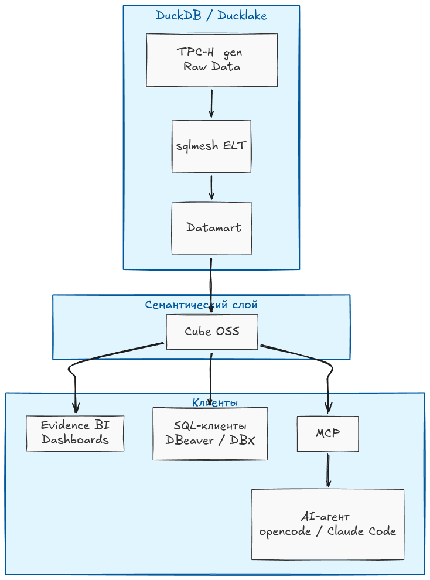

# pocketstack

[](LICENSE)
[](#проверки)
[](#проверки)

Демонстрационный стек локальной аналитики: **TPC-H → DuckDB → sqlmesh → Cube → Evidence**
с верификационным harness'ом (TDD), протоколом оценки производительности запросов
и **MCP-сервером для AI-агентов** поверх семантического слоя.
Всё работает на одной машине, без внешних сервисов.

Репозиторий: <https://github.com/alexanderlazutkin/pocketstack>.

## Два режима работы DWH

Витрина (marts) живёт в одном из двух режимов — переключается переменной
`WAREHOUSE_MODE` и не требует изменения моделей/семантики:

| | **DuckDB file** (основной) | **DuckLake lakehouse** (опция для тренировок) |
|---|---|---|
| Хранение | один файл `warehouse/pocketstack.duckdb` | каталог в PostgreSQL 17 + parquet-файлы в MinIO (S3) |
| Что поднимается | контейнеры serving (cube, evidence) | + контейнеры pg-каталога и MinIO (`docker compose`) |
| Сильная сторона | простота, максимум скорости движка | time-travel по снапшотам, данные вне файла БД, zero-downtime смена sf |
| Данные | `dbgen → sqlmesh` (sf-маршрутизация `just seed/apply`) | тот же dbgen → CTAS в lake одной транзакцией (`just seed-lake/apply-lake`) |
| Проверка | `just verify` / `just bench` | `just verify-lake` / `just bench-lake` (цифры режимов не смешиваются) |
| Смена sf | `just rebuild SF` (лок куба снимается) | `just rebuild-lake SF` (куб НЕ останавливается) |

Режимы независимы: данные каждого строятся отдельно, переключение — это
пересоздание контейнера куба с другим `WAREHOUSE_MODE` (процедуры — `docs/user-guide.md`).

## Цели

1. Показать воспроизводимый, проверяемый локальный data-стек на примере масштабируемых
   данных теста [TPC-H](https://tpc.org/tpch/):
   генерация данных → витрина (звезда) → семантический слой → BI.
2. Единый источник метрик: **вся логика метрик — в Cube** (ROLAP-семантический слой
   над витриной в DuckDB); BI-дашборды — только отображение поверх Cube;
   сложные отклонения (YoY/PoP) — в кубах, а не в дашбордах.
3. Доказуемость цифр: harness из 13 golden-вопросов сверяет три пути
   (Cube REST ↔ SQL API ↔ эталонный SQL к витрине) + лог выполнения DuckDB.
4. AI-агент без «галлюцинаций»: использует описание метаданных в Cube на русском, агент работает через MCP с
   метриками и объясняет формулы по сгенерированному SQL, а не по памяти.

## Архитектура



- **Данные**: TPC-H dbgen (масштабируемый объём, `sf`) → sqlmesh строит витрину-звезду
  (DuckDB file или DuckLake — см. «Два режима»).
- **Serving (контейнеры)**: Cube (REST/GraphQL :4000 + SQL API pg-wire :15432) и
  Evidence (:3000) — профиль `serve` в `docker compose`; на хосте Node не нужен
  (пины Node 24/20.19 зашиты в образы `docker/`).
- **Семантика**: Cube — view `sales`, куб `sales_mov` (YoY/PoP-отклонения), KPI-measures;
  каждый куб/член описан по-русски (`title`/`description` — AI-context).
- **BI**: Evidence — 6 страниц: выручка, отклонения, клиенты, доставка,
  верификация (13 golden-вопросов на одной странице); читает данные только через Cube SQL API.
- **SQL-клиенты**: любой pg-клиент через SQL API :15432 — живая семантика без Cube UI.
- **AI-агент**: pocketstack-mcp — тонкий MCP-сервер (FastMCP, stdio) поверх Cube:
  `cube_meta` / `cube_load` / `cube_sql` / `sql_api`, все read-only.
- **Проверки**: harness — parity/determinism/ground-truth тесты, bench.

## Быстрый старт

### Режим DuckDB (file) — основной

```bash
# 0) предусловия: uv (python 3.12), Docker (Engine + compose v2), just (опц.)
cp .env.example .env && $EDITOR .env   # секреты (openssl rand -hex 32) — вне git
uv sync                                # python-окружение (sqlmesh, harness, duckdb 1.5.5)

just rebuild        # БД с нуля (sf=1) + витрины + контейнеры serving + Evidence sources
                      # транзакционно: сбой → авто-откат предыдущей БД

CUBEJS_DEV_MODE=false just serve-up   # куб в прод-режиме (нужен для RBAC-тестов verify)
just verify         # 88 тестов живого стека: паритет 3 путей + RBAC-матрица
just bench          # 13 вопросов, latency 3 путей
```

### Режим DuckLake (lakehouse) — опция

```bash
docker compose up -d --wait    # инфраструктура: pg-каталог + MinIO (healthchecks)
just seed-lake 1 && just apply-lake    # бакет + данные sf=1 + витрины sqlmesh в lake
WAREHOUSE_MODE=ducklake CUBEJS_DEV_MODE=false just serve-up   # куб на lake (прод)
just verify-lake               # та же сверка 88 тестов, ground truth через ATTACH lake
```

Подключить AI-агента (opencode/Claude Code) к семантическому слою:

```bash
opencode mcp add cube -- uv run --directory /путь/к/pocketstack python -m cube_mcp
```

Сценарии проверки агента (4 демо с эталонными числами sf=1) — `docs/cube-mcp.md` §«Сценарии».

Открыть: **Evidence** http://localhost:3000 · **Cube UI** http://localhost:4000 ·
SQL-клиенты — `docs/cube-sql-clients.md`.

Другой объём данных: `just rebuild 2` (file) / `just rebuild-lake 10` (lake).

## Безопасность

- Креды/токены — только в `.env` (в git не попадает; шаблон `.env.example`).
  Код не содержит секретов и фолбэков: без `.env` компоненты не стартуют.
- **RBAC (docs/cube-rbac.md)**: группы из подписанных JWT (`contextToGroups`) +
  `access_policy` в модели; демо «admin видит всё / user — 3 меры и только свой
  регион» на REST, SQL API (:15432, per-role учётки) и MCP. Прод-режим Cube:
  только JWT, сырой секрет → 403.
- `connection.yaml` Evidence с реальными кредами рендерится из env **внутри
  контейнера** при старте (`docker/evidence/entrypoint.sh`, chmod 600) и не покидает его.
- Все порты стека публикуются только на `127.0.0.1`.
- Известное ограничение: Cube dev слушает все интерфейсы (0.0.0.0, опции привязки
  в dev-сервере Cube нет) — запускайте только на доверенной машине/за файрволом.

## Документация

| Документ | Что внутри |
|---|---|
| `docs/user-guide.md` | **руководство пользователя**: с нуля в обоих режимах, переход между ними, смена sf, сверка цифр |
| `docs/plan.md` | план стадий (со статусами) + реестр вопросов |
| `docs/evidence-setup.md` | Evidence: установка с нуля (host-runbook для отладки вне контейнера) |
| `docs/cube-mcp.md` | MCP-сервер Cube для AI-агентов: семантика на русском, 4 сценария проверки, подключение |
| `docs/cube-rbac.md` | **RBAC в Cube OSS**: access_policy + группы из JWT, демо «Admin vs User» (REST/SQL API/MCP) |
| `docs/cube-sql-clients.md` | DBeaver/DBX к SQL API Cube |
| `docs/cube-oss-vs-enterprise.md` | Cube OSS vs Enterprise: что есть в self-hosted, лимиты Cloud, OSS-альтернативы (исследовательский снимок) |
| `docs/upstream-components.md` | реестр сторонних компонентов: пины + кодовые отклонения (аудит, ожидаемо 0) |
| `docs/bi-tools-comparison.md` | сравнение BI-инструментов (исследовательский снимок, выбор Evidence) |
| `docs/bench-protocol.md` | протокол оценки запросов (два режима) |
| `docs/gotchas.md` | нюансы и грабли: симптом → причина → решение |

Skills для AI-агента (правила работы с кубами pocketstack через MCP):
`.opencode/skills/` — `cube-explore-model`, `cube-build-model`, `cube-run-query`.

## Управление стеком

Serving и lake-инфраструктура — `docker compose` (профиль `serve`):

```bash
just serve-up      # поднять cube+evidence (+ ducklake-инфраструктуру, если не поднята)
just serve-down    # снять serving, не трогая lake-инфраструктуру
just cube-stop     # снять лок куба перед just apply/reset в file-режиме
just rebuild SF    # полный пересбор file-режима (транзакционно)
just rebuild-lake SF  # полный пересбор ducklake-режима (без остановки куба)
docker compose ps / logs cube evidence   # состояние и логи
```

## Проверки

`just test` — 141 тест (модель, harness, MCP: unit + e2e);
`just verify` — 88 проверок живого стека (REST ↔ SQL API ↔ reference ↔ ground truth + RBAC «Admin vs User»);
итог — `artifacts/verify-report.md` (13/13 по всем осям).

## Статусы стадий

Stage 0–5 завершены (✅ 2026-10-25/26); Stage 6 (выравнивание DuckDB 1.5.5) и
Stage 7 (ducklake + контейнеризация, шаги 1–8.1) — ✅ 2026-10-28/29; Stage 9
(ревью/документация) — в работе. См. `docs/plan.md`.
